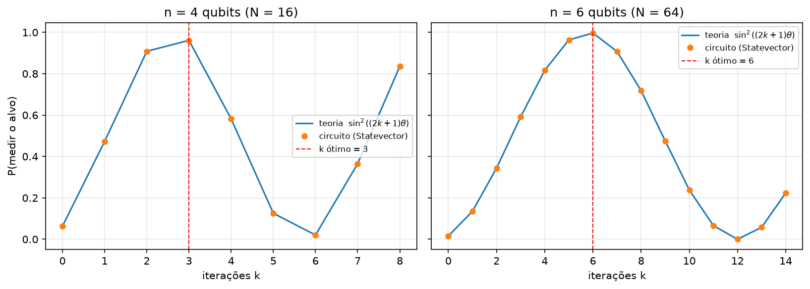
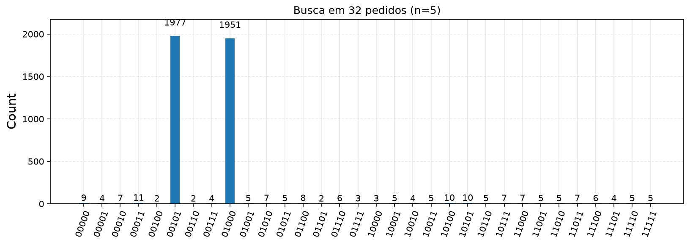
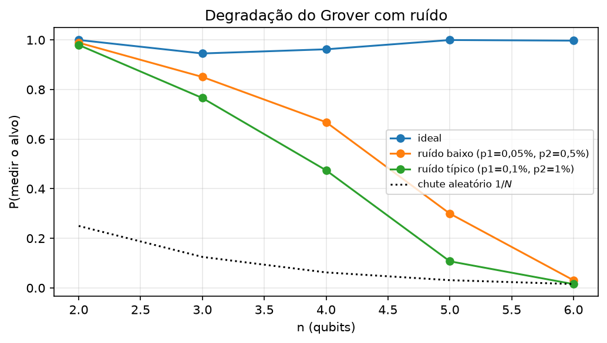
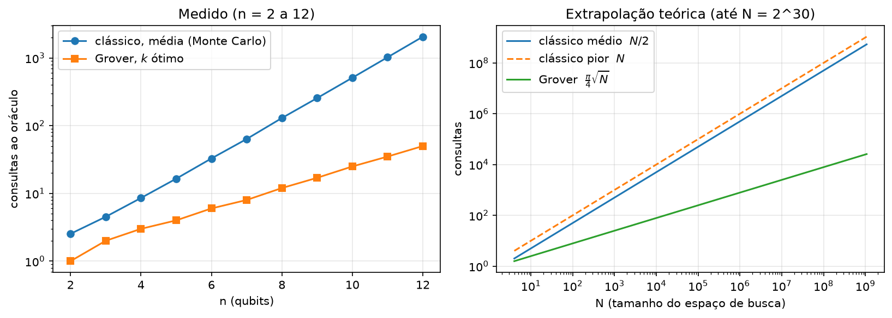

::: {.capa}
# Algoritmo de Grover: fundamentação, implementação em Qiskit e comparação com a busca clássica

**Relatório técnico**

Computação Quântica, curso de Sistemas de Informação

Integrantes: *[nomes do grupo]*

*[Instituição]*, *[mês/ano]*
:::

## 1. Introdução

Procurar um item em uma coleção sem ordem e sem índice é uma tarefa comum em Sistemas de Informação. Pense numa lista de um milhão de nomes embaralhados: sem nenhuma organização, a única saída é olhar um por um. Com $N$ itens e um único item procurado, isso exige em média $(N+1)/2$ verificações (cerca de 500 mil, no exemplo) e, no pior caso, $N$.

Em 1996, Lov Grover mostrou que um computador quântico resolve esse problema com cerca de $\sqrt{N}$ verificações [1]. No exemplo do milhão de nomes, seriam cerca de 785. O ganho é chamado de **quadrático** (a raiz quadrada do tamanho da lista). Ele é menor que o ganho exponencial do algoritmo de Shor, mas vale para qualquer problema que possa ser descrito como uma busca, como quebrar uma senha por tentativa ou resolver um problema de satisfatibilidade booleana.

> **Em palavras simples:** o algoritmo de Grover é uma forma de achar uma agulha num palheiro desorganizado olhando muito menos palha do que um computador comum precisaria.

Os objetivos deste trabalho são:

1. explicar o algoritmo de Grover a quem não conhece computação quântica (seção 2);
2. implementá-lo em Qiskit e validá-lo em simulador (seções 3 e 4);
3. compará-lo com a busca clássica (seção 5);
4. discutir suas limitações práticas, como o custo do oráculo e o ruído do hardware (seções 4 e 6).

O código completo está no notebook `grover_qiskit.ipynb`, entregue junto com este relatório.

## 2. Fundamentação teórica

### 2.1 Ideias básicas de computação quântica

Um computador comum guarda a informação em **bits**, que valem 0 ou 1. Um computador quântico usa **qubits**. Um qubit pode estar em 0, em 1 ou em uma **superposição** dos dois, isto é, uma combinação em que cada valor recebe uma "nota", chamada **amplitude**. Com $n$ qubits, a superposição pode atribuir uma amplitude a cada um dos $N = 2^n$ valores possíveis ao mesmo tempo.

A regra que conecta a teoria à prática é a **medida**: ao olhar o resultado, obtém-se um único valor, e a chance de sair cada valor é o **quadrado** da sua amplitude. Amplitudes também podem ser negativas, o que é essencial no algoritmo. A computação é descrita por **portas quânticas** (operações sobre os qubits) organizadas em um **circuito**.

Uma ressalva importante: ter todos os valores em superposição **não** significa que se obtém todas as respostas. Se o sistema fosse medido logo após a superposição inicial, sairia um valor aleatório. O trabalho do algoritmo é alterar as amplitudes para que, no momento da medida, a resposta certa seja muito mais provável que as outras.

### 2.2 Problema de busca e oráculo

Há $N = 2^n$ itens, numerados por $n$ bits. Dentre eles, $M$ itens são os procurados (os **marcados**). Existe uma função $f$ que responde se um item é marcado ($f(x)=1$) ou não ($f(x)=0$), e ela só pode ser usada como uma **caixa-preta**: o algoritmo pergunta sobre um item e recebe sim ou não, sem ver o interior da função. O custo do algoritmo é o número de perguntas, chamadas de **consultas**.

No computador quântico, essa caixa-preta é o **oráculo**: um trecho do circuito que, para cada item marcado, inverte o sinal da sua amplitude:

$$O|x\rangle = (-1)^{f(x)}|x\rangle .$$

Itens não marcados ficam como estão. Observe que o oráculo só *marca* o alvo, sem dizer qual ele é. Marcar não é achar: quem faz o alvo aparecer é o passo seguinte.

### 2.3 A ideia do algoritmo, com um exemplo de 4 itens

O algoritmo parte da superposição uniforme, em que todos os itens têm a mesma amplitude, e repete dois passos:

1. **Marcar (oráculo):** inverte o sinal da amplitude do alvo.
2. **Amplificar (difusor):** substitui cada amplitude $a$ por $2m - a$, em que $m$ é a **média** de todas as amplitudes (uma "reflexão em torno da média").

Veja o caso mais simples, com $N = 4$ itens e o alvo na posição 3:

| Etapa | Pos. 0 | Pos. 1 | Pos. 2 | Pos. 3 (alvo) | Média $m$ |
|---|--:|--:|--:|--:|--:|
| Início (todos iguais) | 0,5 | 0,5 | 0,5 | 0,5 | 0,5 |
| Oráculo (inverte o alvo) | 0,5 | 0,5 | 0,5 | $-0\mathord{,}5$ | 0,25 |
| Difusor ($2m - a$) | 0 | 0 | 0 | 1 | 0,25 |

: Tabela 1. Grover com $N=4$: uma iteração basta para chegar à amplitude 1 no alvo.

Como a chance é o quadrado da amplitude, o alvo passa de $0\mathord{,}5^2 = 25\%$ para $1^2 = 100\%$ em uma única repetição. O sinal negativo do alvo puxa a média para baixo, e o espelhamento em torno da média joga o alvo para muito cima e os demais para perto de zero. Em listas maiores, uma repetição não basta, mas o efeito é o mesmo: a cada repetição a amplitude do alvo cresce um pouco mais. A Figura 1 mostra isso para $N=8$.

{width=100%}

Esse processo chama-se **amplificação de amplitude**. O algoritmo completo é:

1. aplicar a porta de Hadamard em todos os $n$ qubits, o que cria a superposição uniforme $|s\rangle = \frac{1}{\sqrt{N}}\sum_{x}|x\rangle$;
2. repetir $k$ vezes o par "oráculo seguido de difusor", que chamamos de **iteração de Grover** $G = D\,O$, com $D = 2|s\rangle\langle s| - I$;
3. medir os $n$ qubits.

### 2.4 Por que funciona: a visão geométrica

*(Esta seção é a justificativa matemática; quem só quer a intuição pode ir direto à seção 2.5.)*

Defina o estado dos itens marcados $|w\rangle$ e o dos não marcados $|\alpha\rangle$:

$$|w\rangle = \frac{1}{\sqrt{M}}\sum_{f(x)=1}|x\rangle, \qquad |\alpha\rangle = \frac{1}{\sqrt{N-M}}\sum_{f(x)=0}|x\rangle .$$

O estado inicial fica num plano gerado por esses dois, formando com $|\alpha\rangle$ um ângulo $\theta$ pequeno:

$$|s\rangle = \sin\theta\,|w\rangle + \cos\theta\,|\alpha\rangle, \qquad \sin\theta = \sqrt{M/N}.$$

Nesse plano, o oráculo é uma reflexão em torno de $|\alpha\rangle$ e o difusor é uma reflexão em torno de $|s\rangle$. Duas reflexões em sequência formam uma rotação, de ângulo igual ao dobro do ângulo entre os dois eixos. Assim, cada iteração gira o estado de $2\theta$ em direção a $|w\rangle$, e depois de $k$ iterações

$$G^k|s\rangle = \sin\big((2k+1)\theta\big)|w\rangle + \cos\big((2k+1)\theta\big)|\alpha\rangle .$$

A probabilidade de medir um item marcado é, portanto,

$$P_k = \sin^2\big((2k+1)\theta\big). \tag{1}$$

> **Em palavras simples:** cada iteração é um pequeno giro que aproxima o estado do alvo. Se o giro for interrompido na hora certa, o estado aponta quase exatamente para o alvo.

### 2.5 Quantas repetições fazer

A probabilidade $P_k$ é máxima quando $(2k+1)\theta \approx \pi/2$, o que dá

$$k_{\text{ótimo}} = \operatorname{round}\!\left(\frac{\pi}{4\theta} - \frac12\right) \approx \frac{\pi}{4}\sqrt{\frac{N}{M}} . \tag{2}$$

Como $k$ é inteiro, a probabilidade nem sempre chega a 100%: para $N=8$ e $M=1$, $k=2$ e $P_2 \approx 94\mathord{,}5\%$. Também é preciso **parar na hora certa**. Como num balanço empurrado, fazer mais repetições do que o ideal faz o estado passar do alvo e a probabilidade volta a cair (Figura 4). Por isso o algoritmo precisa conhecer $M$, ou estimá-lo por contagem quântica, ou usar a variante de Boyer, Brassard, Høyer e Tapp [2], que funciona com $M$ desconhecido.

### 2.6 Complexidade e otimalidade

Para $M=1$, o algoritmo faz $\approx \frac{\pi}{4}\sqrt{N}$ consultas ao oráculo. Bennett, Bernstein, Brassard e Vazirani provaram que nenhum algoritmo quântico resolve a busca sem estrutura com menos de $\Omega(\sqrt{N})$ consultas [3], e Zalka mostrou que Grover é ótimo até nas constantes [4]. Ou seja, o ganho quadrático é o máximo possível para esse tipo de problema. Para $N = 2^{30}$ (cerca de $10^9$ itens), a busca linear faz em média $5\mathord{,}4\times10^8$ consultas e Grover faz cerca de $2\mathord{,}6\times10^4$.

### 2.7 Limitações

- **Custo do oráculo.** Contar apenas as consultas ignora o custo de construir o circuito que avalia $f$; cada consulta custa tanto quanto esse circuito.
- **Acesso aos dados.** Para buscar em dados clássicos armazenados, seria necessária uma memória quântica de acesso aleatório (QRAM), que não existe em escala prática. Só carregar os $N$ registros já custa $O(N)$.
- **Estrutura.** Bancos de dados reais têm índices e a busca custa $O(\log N)$ ou $O(1)$. Grover só ganha de busca *sem* estrutura.
- **Ruído.** O circuito de cada iteração é profundo, e os erros das portas se acumulam (seção 4.6).

## 3. Implementação em Qiskit

Usamos Qiskit 2.6, o simulador `qiskit-aer` 0.18 e Python 3.13. Qiskit é uma biblioteca Python da IBM para montar e simular circuitos quânticos. Três funções formam o programa:

- **Oráculo** (`oraculo`): inverte a fase só do estado marcado. Para isso, aplica portas $X$ nos qubits em que o alvo tem bit 0 (assim o alvo vira "todos 1"), usa uma porta $Z$ controlada por todos os qubits (que só atua quando todos valem 1) e desfaz as portas $X$.
- **Difusor** (`difusor`): $H^{\otimes n}$, $X^{\otimes n}$, $Z$ multicontrolada, $X^{\otimes n}$, $H^{\otimes n}$. Isso implementa $I - 2|s\rangle\langle s|$, que difere do difusor teórico apenas por um sinal global, sem efeito nas probabilidades.
- **Circuito** (`grover`): $H^{\otimes n}$, $k$ repetições de oráculo e difusor, e medida. O valor de $k$ vem da Equação (2).

{width=100%}

O Qiskit escreve os bits do qubit menos significativo ($q_0$) para o mais significativo; assim, o alvo `101` é o número 5.

## 4. Resultados

### 4.1 Validação com $n=3$

Com $N=8$, alvo `101` e $k=2$, a teoria prevê 94,5% (Equação 1). Em 4096 execuções do circuito no simulador, o estado `101` saiu 3855 vezes (94,1%), e cada um dos outros sete saiu entre 23 e 44 vezes.

{width=55%}

### 4.2 Probabilidade em função do número de iterações

A Figura 4 compara a Equação (1) com o que o circuito entrega (cálculo exato do vetor de estado), para $n=4$ e $n=6$. A maior diferença, para $n=5$ e $k$ de 0 a 11, foi de $1\mathord{,}0\times10^{-13}$, ou seja, o circuito faz o giro previsto pela teoria. O gráfico também mostra que, passado o máximo, a probabilidade cai.

{width=95%}

### 4.3 Escalabilidade

A Tabela 2 mostra o resultado para $n$ de 2 a 10, com um item marcado. A profundidade (número de camadas de portas) e o número de portas CX (portas de 2 qubits, as mais sujeitas a erro) foram medidos após traduzir o circuito para portas básicas ($u$ e $cx$).

| $n$ | $N$ | $k$ | $P$ (circuito) | Profundidade | Portas CX |
|--:|--:|--:|--:|--:|--:|
| 2 | 4 | 1 | 1,0000 | 6 | 2 |
| 3 | 8 | 2 | 0,9453 | 46 | 24 |
| 4 | 16 | 3 | 0,9613 | 160 | 84 |
| 5 | 32 | 4 | 0,9992 | 517 | 288 |
| 6 | 64 | 6 | 0,9966 | 1219 | 984 |
| 7 | 128 | 8 | 0,9956 | 2073 | 1952 |
| 8 | 256 | 12 | 0,9999 | 3781 | 4080 |
| 9 | 512 | 17 | 0,9994 | 6308 | 7684 |
| 10 | 1024 | 25 | 0,9995 | 10676 | 14500 |

: Tabela 2. Iterações, probabilidade de sucesso e custo do circuito completo.

A probabilidade de sucesso fica acima de 94% em todos os casos. O custo, porém, cresce muito: de 2 para 14500 portas CX. Isso acontece porque cada iteração tem duas portas $X$ controladas por $n-1$ qubits, e uma porta assim, sem qubits auxiliares, vira muitas portas simples. Com qubits auxiliares o custo cairia para linear em $n$, ao preço de mais qubits.

### 4.4 Vários itens marcados

Com $n=4$ ($N=16$) e $M=1$, 2 e 4 itens marcados, o número ótimo de iterações é 3, 2 e 1, e as probabilidades do circuito (0,9613, 0,9453 e 1,0000) coincidem com a teoria. Quanto mais itens procurados, menos iterações são necessárias, como indica a Equação (2).

### 4.5 Aplicação: busca em uma tabela de pedidos

Para ilustrar o uso em Sistemas de Informação, o notebook gera uma tabela de 32 pedidos (`id_pedido`, `status`, `valor`) e procura os atrasados com valor acima de 8000. Cinco qubits numeram as 32 linhas. A tabela gerada tem $M=2$ linhas que atendem ao critério (linhas 5 e 8), então $k=3$.

Em 4096 execuções, 95,9% dos resultados caíram em uma das duas linhas corretas, em linha com os 96,1% previstos. A linha 5 foi a mais frequente (48,3% das vezes).

{width=80%}

**Ressalva:** o oráculo deste exemplo foi montado a partir dos índices que atendem ao critério, calculados de forma clássica. Isso demonstra o fluxo do algoritmo, mas não é uma busca de verdade. Num caso real, o oráculo teria de avaliar o critério sobre os dados dentro do circuito, o que traz o problema de acesso aos dados da seção 2.7.

### 4.6 Efeito do ruído

Computadores quânticos reais cometem erros em cada porta. Para estimar o efeito, simulamos o circuito com um modelo de ruído sintético: erro de 0,05% (ou 0,1%) nas portas de 1 qubit e de 0,5% (ou 1%) nas portas CX. Esses valores têm a ordem de grandeza de processadores atuais, mas não representam um aparelho específico.

| $n$ | Ideal | Ruído baixo | Ruído típico | Chute aleatório ($1/N$) |
|--:|--:|--:|--:|--:|
| 2 | 1,000 | 0,989 | 0,980 | 0,250 |
| 3 | 0,946 | 0,851 | 0,766 | 0,125 |
| 4 | 0,962 | 0,668 | 0,474 | 0,063 |
| 5 | 1,000 | 0,300 | 0,107 | 0,031 |
| 6 | 0,997 | 0,031 | 0,015 | 0,016 |

: Tabela 3. Probabilidade de medir o alvo, com e sem ruído (4096 execuções).

Com o ruído típico, a probabilidade cai de 0,98 para 0,015 entre $n=2$ e $n=6$; em $n=6$ o resultado já não se distingue de um chute aleatório. Isso acompanha o número de portas CX da Tabela 2: circuitos maiores acumulam mais erro. Por isso, hoje o algoritmo só é executável em hardware real para valores muito pequenos de $n$.

{width=55%}

### 4.7 Execução em hardware real (IBM Quantum)

*[A PREENCHER PELO GRUPO. A seção 9 do notebook roda o circuito de $n=3$ em um backend da IBM Quantum quando a variável de ambiente `IBM_QUANTUM_TOKEN` está definida. Nesta versão do relatório a execução em hardware ainda não foi feita, e portanto não há resultado a apresentar. Após executar, inserir aqui o nome do backend, a profundidade do circuito, o histograma e a comparação com o simulador ideal.]*

## 5. Comparação com a abordagem clássica

### 5.1 Número de consultas

A abordagem clássica equivalente é a busca linear em ordem aleatória. A Tabela 4 compara o número médio de consultas, medido por simulação de Monte Carlo (3000 execuções por $n$), com o número de iterações de Grover. Cada iteração de Grover usa uma consulta ao oráculo.

| $n$ | $N$ | Clássico (média) | Clássico (pior caso) | Grover ($k$) | $P$ de sucesso |
|--:|--:|--:|--:|--:|--:|
| 4 | 16 | 8,6 | 16 | 3 | 0,961 |
| 6 | 64 | 32,8 | 64 | 6 | 0,997 |
| 8 | 256 | 129,7 | 256 | 12 | 1,000 |
| 10 | 1024 | 509,8 | 1024 | 25 | 1,000 |
| 12 | 4096 | 2056,6 | 4096 | 50 | 1,000 |

: Tabela 4. Consultas ao oráculo: busca linear e Grover.

A média clássica fica em $\approx N/2$, como previsto, e Grover cresce como $\sqrt{N}$. Para $N=4096$, são 2056,6 consultas contra 50, cerca de 41 vezes menos, e a razão aumenta com $N$ (Figura 7, painel direito). A busca clássica acerta com certeza ao final; Grover acerta com probabilidade próxima de 1 e, se $P<1$, o resultado precisa ser conferido com uma consulta clássica.

{width=95%}

### 5.2 Tempo de relógio

Medimos também o tempo da busca linear em Python e do circuito de Grover no simulador `AerSimulator` (1024 execuções).

| $n$ | $N$ | Busca linear (s) | Grover simulado (s) |
|--:|--:|--:|--:|
| 8 | 256 | $1\mathord{,}2\times10^{-5}$ | 0,021 |
| 10 | 1024 | $3\mathord{,}0\times10^{-6}$ | 0,061 |
| 12 | 4096 | $2\mathord{,}1\times10^{-4}$ | 0,172 |
| 14 | 16384 | $4\mathord{,}3\times10^{-4}$ | 0,690 |

: Tabela 5. Tempo de execução em um computador comum (uma medição por linha; os tempos da busca linear são muito pequenos e variam entre medições).

No simulador, Grover é mais lento que a busca linear em todos os tamanhos, e o tempo praticamente dobra a cada qubit a mais, porque simular $n$ qubits exige manipular $2^n$ amplitudes. O ganho de Grover está nas **consultas** em um computador quântico físico, e não no tempo de simulação. O simulador serve para conferir se o circuito está correto, não para ganhar desempenho.

## 6. Conclusão

- O circuito reproduz a probabilidade teórica $\sin^2((2k+1)\theta)$: diferença da ordem de $10^{-13}$ para $n=5$, e valores iguais em quatro casas decimais para todo $n$ de 2 a 10.
- O número de consultas cresce como $\sqrt{N}$, contra $N/2$ da busca linear: com $N=4096$, são 50 contra 2056,6. O ganho é quadrático e, segundo a teoria, é o máximo possível para busca sem estrutura [3, 4].
- No simulador não há ganho de tempo, pois simular $n$ qubits custa cerca de $2^n$.
- O custo de cada iteração cresce com $n$ (14500 portas CX para $n=10$). No modelo de ruído usado, a probabilidade de sucesso cai a 0,107 para $n=5$ e a 0,015 para $n=6$, próximo do chute aleatório. Com o hardware atual, o algoritmo é uma demonstração, não uma ferramenta prática.
- Em aplicações de dados, o gargalo é construir o oráculo e carregar os dados em forma quântica. Em bancos com índices, a busca clássica já é mais rápida que Grover.

> **Em uma frase:** Grover reduz o número de verificações de $N$ para cerca de $\sqrt{N}$ em buscas sem ordem, mas o ganho depende de hardware quântico livre de erros e de um oráculo eficiente, que ainda não existem em escala prática.

## Referências

[1] L. K. Grover. A fast quantum mechanical algorithm for database search. *Proceedings of the 28th ACM Symposium on Theory of Computing (STOC)*, 1996, p. 212-219.

[2] M. Boyer, G. Brassard, P. Høyer, A. Tapp. Tight bounds on quantum searching. *Fortschritte der Physik*, v. 46, 1998, p. 493-505.

[3] C. H. Bennett, E. Bernstein, G. Brassard, U. Vazirani. Strengths and weaknesses of quantum computing. *SIAM Journal on Computing*, v. 26, n. 5, 1997, p. 1510-1523.

[4] C. Zalka. Grover's quantum searching algorithm is optimal. *Physical Review A*, v. 60, 1999, p. 2746-2751.

[5] M. A. Nielsen, I. L. Chuang. *Quantum Computation and Quantum Information*. Cambridge University Press, 2010. Capítulo 6.

[6] Qiskit. Documentação do Qiskit e do Qiskit Aer. https://quantum.cloud.ibm.com/docs
